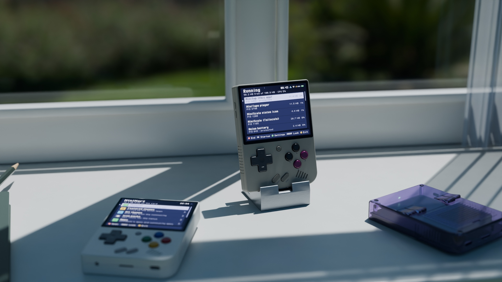
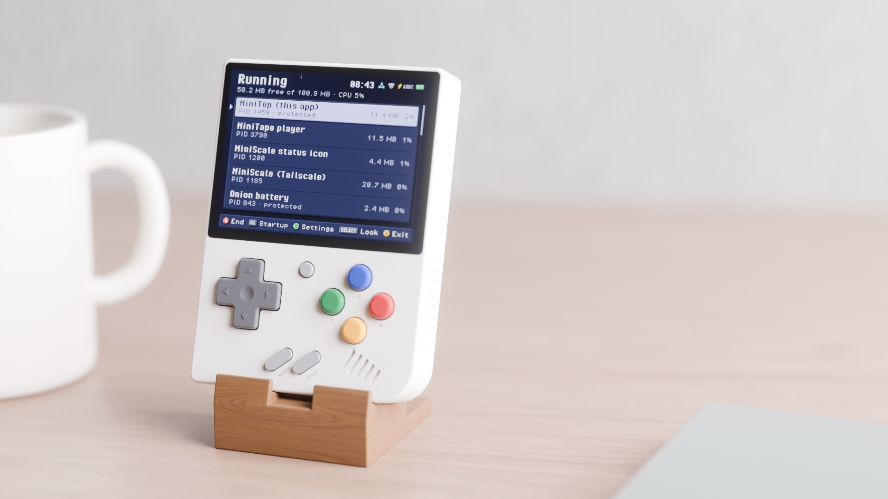

<p align="center"></p>

[](https://github.com/zakijss/MiniTop/actions/workflows/ci.yml)
[](https://github.com/zakijss/MiniTop/releases)
[](LICENSE)

# MiniTop

Tasks and maintenance for a Miyoo Mini Plus: what's running, what starts at boot and what fills the SD card. It also keeps the clock right. Part of [MiniDeck](https://github.com/zakijss/MiniDeck).

- Running programs with their memory and CPU use; **A** ends one (Onion's own processes are protected). **Y** sorts them by CPU, memory or name and can hide Onion's own.
- The scripts Onion runs at boot, each turned on or off.
- Storage: free space on the card, and how much each folder takes, largest first (Roms by system, App by app). **A** opens a folder; **X** deletes the selected file or folder after asking.
- Clean up (**X** on Storage): MiniMart's downloads, MiniTape's saved songs, Onion's game list caches, logs, macOS leftovers (`._` files, `.DS_Store`, `.Trashes`) and empty folders. Each one lists exactly what it deletes before you confirm. Games, saves and settings are never part of a clean-up.
- `clocksync`: a boot script that sets the clock from HTTPS servers once Wi-Fi is up, since Onion's own time sync relies on a service that no longer answers.


<p align="center"></p>

## Using it

**L1**/**R1** move between Running, Startup and Storage. Measuring the card takes a few seconds and runs in the background. The card has no trash, so a delete is final. MiniTop won't delete Onion's files, the card's top-level folders, whole app folders (remove apps in MiniMart, which also takes out their boot scripts), MiniKey's vault, or any key or `.enc` file. For daylight saving, put a zone name such as `Europe/Berlin` in `App/MiniTop/timezone`. Turn clocksync off in the startup tab.

## Install

- **MiniMart:** open [MiniMart](https://github.com/zakijss/MiniMart), then **Apps > MiniTop**. It checks the download and keeps your settings on updates.
- **Zip:** download `minitop-VERSION.zip` from [Releases](https://github.com/zakijss/MiniTop/releases/latest), unzip it onto the root of the SD card, and restart.
- **Every MiniDeck app at once:** [minideck-all.zip](https://github.com/zakijss/MiniDeck/releases/latest/download/minideck-all.zip).

## Requirements

A Miyoo Mini Plus on Onion OS 4.4, with Wi-Fi. Other devices and firmwares aren't supported.

## Building

```sh
make check                     # vet, tests, scripts
make package VERSION=1.0.0     # dist/: the release zip, app.json, SHA256SUMS
make deploy HOST=root@miyoo    # build and copy to a device over SSH
```

Go runs in Docker unless you pass `GO=go` (Go 1.27). The interface, themes and networking come from the [MiniDeck library](https://github.com/zakijss/MiniDeck); see its [development notes](https://github.com/zakijss/MiniDeck/blob/main/docs/DEVELOPMENT.md) and [contributing guide](https://github.com/zakijss/MiniDeck/blob/main/CONTRIBUTING.md).

## License

[MIT](LICENSE). Third-party components are listed in [NOTICE](NOTICE). Not made by or affiliated with Miyoo.
