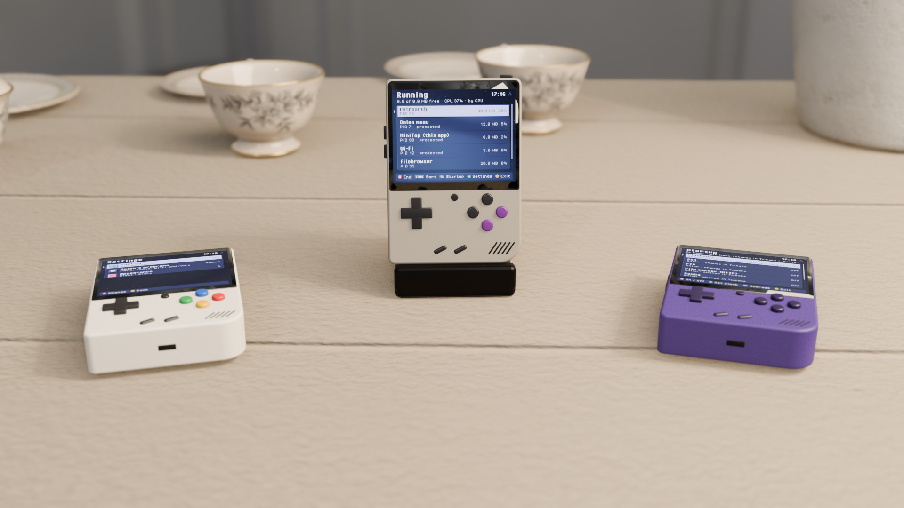
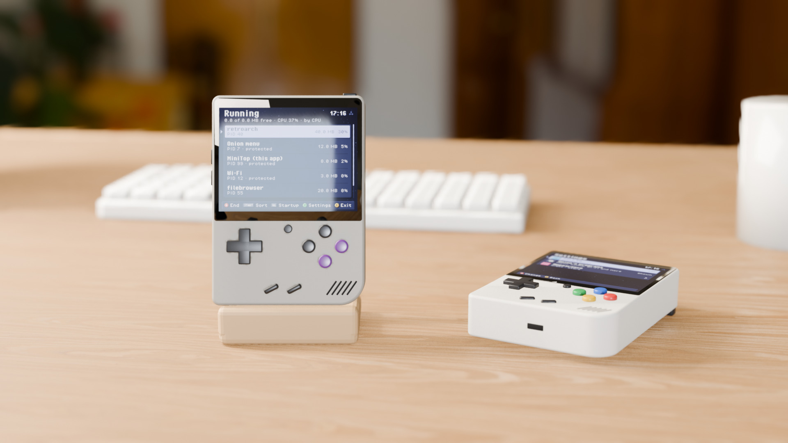

<p align="center"></p>

[](https://github.com/zakijss/MiniTop/actions/workflows/ci.yml)
[](https://github.com/zakijss/MiniTop/releases)
[](LICENSE)

# MiniTop

What's running on a Miyoo Mini Plus, what starts at boot and what fills the SD card. It also keeps the clock right. Part of [MiniDeck](https://github.com/zakijss/MiniDeck).

- **Running:** programs with their memory and CPU use, and the free memory and swap above them. **A** ends one after asking (Onion's own processes are protected).
- **Startup:** the scripts Onion runs at boot, each turned on or off from the next boot.
- **Storage:** free space on the card and how much each folder takes, largest first (Roms by system, App by app). **A** opens a folder; inside one, **X** deletes the selected file or folder after asking.
- **Clean up** (**X** on Storage): MiniMart's downloads, MiniTape's saved songs, Onion's game list caches, logs, macOS leftovers (`._` files, `.DS_Store`, `.Trashes`) and empty folders. Each one lists what it deletes before you confirm; games, saves and settings are never part of it.
- **Duplicates** (**Y** on Storage): games under `Roms` that are byte for byte the same. **X** deletes one copy after asking; the last copy, and a disc that a `.cue`, `.m3u`, `.gdi` or `.ccd` names, are kept.
- **clocksync:** a boot script that sets the clock from HTTPS servers once Wi-Fi is up, since Onion's own time sync relies on a service that no longer answers.

<p align="center"></p>

## Install

Open [MiniMart](https://github.com/zakijss/MiniMart) and pick **Apps > MiniTop**: it checks the download and keeps your settings on updates. Or unzip `minitop-VERSION.zip` from [Releases](https://github.com/zakijss/MiniTop/releases/latest) onto the root of the SD card and restart. Every MiniDeck app comes in one zip too: [minideck-all.zip](https://github.com/zakijss/MiniDeck/releases/latest/download/minideck-all.zip).

Needs a Miyoo Mini Plus on Onion OS 4.4, with Wi-Fi. Other devices and firmwares aren't supported.

## Using it

**L1**/**R1** move between Running, Startup and Storage, **L2**/**R2** jump to the top or bottom of a list, and **SELECT** opens Appearance. On Running, **START** sorts by CPU, memory or name and **Y** opens Settings, which can also hide Onion's own processes. On Startup, **X** sets the clock now, for when Wi-Fi came up after boot; clocksync is turned off there too. On Storage, **START** measures the card again (it takes a few seconds, in the background).

A program is asked to quit and forced two seconds later. MiniFin's video player and ffplay are never forced, since forcing a video player can freeze the screen until a restart.

The card has no trash, so a delete is final. MiniTop won't delete Onion's files, the card's top-level folders, whole app folders (remove apps in MiniMart, which also takes out their boot scripts), MiniKey's vault, or any key or `.enc` file.

For daylight saving, put a zone name such as `Europe/Berlin` in `App/MiniTop/timezone`.

## Building

```sh
make check                     # vet, tests, scripts
make package VERSION=1.0.0     # dist/: the release zip, app.json, SHA256SUMS
make deploy HOST=root@miyoo    # build and copy to a device over SSH
```

Go runs in Docker unless you pass `GO=go` (Go 1.27). The interface, themes and networking come from the [MiniDeck library](https://github.com/zakijss/MiniDeck); see its [development notes](https://github.com/zakijss/MiniDeck/blob/main/docs/DEVELOPMENT.md) and [contributing guide](https://github.com/zakijss/MiniDeck/blob/main/CONTRIBUTING.md).

## License

[MIT](LICENSE). Third-party components are listed in [NOTICE](NOTICE). Not made by or affiliated with Miyoo.
